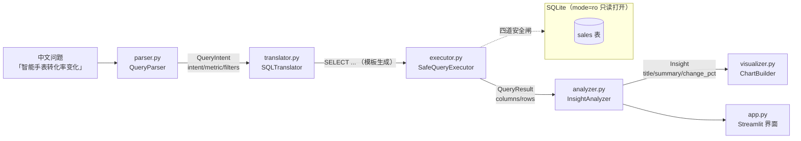

# InsightAgent · 用一句中文问出业务结论的数据分析 Agent

> 输入「智能手表转化率变化」，输出一句能直接放进周报的结论、一条可审计的 SQL、一张能贴进汇报的图。
> 全程不调用任何大模型，纯规则引擎 —— 因为数据分析场景里，"猜错"比"查不出"的代价高得多。

演示数据：某品牌三款可穿戴设备（智能手表 / 蓝牙耳机 / 运动手环）2025 年全年逐月销售表，共 36 行。

```
$ python run_demo.py

[1] 问：哪个产品销售额最高
    意图: ranking / 指标: revenue
    结论: 智能手表 销售额最高
          按销售额排名，智能手表以 ¥7,101,000 居首，其后是 蓝牙耳机、运动手环。
------------------------------------------------------------------
[2] 问：智能手表销售额环比变化
    结论: 销售额环比下降 59.9%
          2025-12 的销售额为 ¥401,000，相比 2025-11 的 ¥1,000,000 下降 59.9%。
    风险: critical
------------------------------------------------------------------
[3] 问：智能手表转化率变化
    结论: 转化率环比下降 55.3%
          2025-12 的转化率为 0.89%，相比 2025-11 的 2.00% 下降 55.3%。
    风险: critical
```

---

## 一、这个项目解决什么问题

业务方想知道的从来不是 SQL，而是"哪个卖得最好""这个月为什么掉了"。传统链路上，这三句话要经过
「业务提需求 → 分析师写 SQL → Excel 出图 → 贴 PPT」四道手，一轮下来半天没了。

InsightAgent 把这条链路压成一次提问，同时保留两样东西：

1. **可审计**：每个结论都跟着它对应的 SQL 原文，结论错了能立刻定位是解析错、翻译错还是数据错；
2. **可控**：SQL 由模板生成、只读执行、表白名单、行数上限四道闸，即使输入被恶意构造也写不进数据库。

## 二、架构



| 层 | 文件 | 职责 | 关键设计 |
|---|---|---|---|
| 模型层 | `src/models/query.py`、`result.py` | `QueryIntent` / `QueryResult` / `Insight` | Pydantic 校验，层与层之间只传模型不传裸 dict |
| 解析层 | `src/parser.py` | 中文 → 结构化意图 | 关键词规则，顺序敏感（异常 > 对比 > 排名 > 趋势 > 汇总） |
| 翻译层 | `src/translator.py` | 意图 → SQL | 模板固定，表名列名写死，不接受外部拼接 |
| 执行层 | `src/executor.py` | 安全执行 SQL | 只读连接 + 单条 SELECT + 关键字黑名单 + 表白名单 + 行数上限 |
| 分析层 | `src/analyzer.py` | 结果 → 业务结论 | 环比计算、30% 异常阈值分级、指标格式化（¥ / %） |
| 可视化层 | `src/visualizer.py` | 结果 → 图表 | 函数式返回 `Figure`，不依赖 pyplot 全局状态，Agg 后端可跑 CI |
| 编排层 | `src/agent.py` | 串起上面五层 | `agent.explore(question)` 一次返回意图 / SQL / 结果 / 结论 |
| 界面层 | `src/app.py` | Streamlit 交互 | 上传 CSV/Excel、示例问题、表格 + 结论 + 图 |

## 三、SQL 安全是怎么做的

四道闸互相独立，任何一道被绕过，后面还有一道兜着：

```python
# 1) 语句级：必须是单条 SELECT，且不允许注释（注释可用来截断后续校验）
if "--" in raw or "/*" in raw:      raise UnsafeQueryError("不允许 SQL 注释")
if not re.match(r"^select\b", body, re.IGNORECASE): raise UnsafeQueryError("只允许 SELECT")

# 2) 词法级：DDL / DML / 事务 / PRAGMA 全部禁掉
hit = tokens & {"insert", "update", "delete", "drop", "alter", "pragma", ...}

# 3) 对象级：FROM / JOIN 的表必须在白名单内
unknown = tables - {"sales"}

# 4) 连接级：数据库以只读模式打开，写操作在引擎层被拒绝
uri = "file:" + db_path + "?mode=ro"
```

对应的 8 个测试覆盖了 `INSERT`、`DROP`、跨表、多语句、注释注入、行数截断等路径。

## 四、快速开始

```bash
cd insightagent
python -m pip install -r requirements.txt

# 1) 跑测试（31 个用例）
python -m pytest tests/ -v

# 2) 跑 Demo（5 个问题 + 关键指标自动校验）
python run_demo.py

# 3) 起交互界面
streamlit run src/app.py
```

`run_demo.py` 会把图表写到 `demo_output/`，并在末尾自动比对三个预期指标：

```
  关键指标校验
    销售额最高产品      : 智能手表  ✓
    智能手表销售额环比  : -59.9%  ✓
    智能手表转化率环比  : -55.3%  ✓
```

### 换自己的数据

CSV / Excel 必需列：`month, product, units_sold, unit_price, revenue, visitors, conversions`。
`conversion_rate` 可以不给，会自动按 `conversions / visitors * 100` 回算。清洗规则是"脏行直接丢弃"
而不是猜一个值填回去 —— 分析场景里，静默填补比少一行数据更危险。

```python
from src.agent import InsightAgent

agent = InsightAgent(db_path="my.db", dataset_path="my_sales.xlsx")
out = agent.explore("蓝牙耳机近半年销售额趋势")
print(out["sql"])             # 可审计的 SQL
print(out["insight"].summary) # 一句业务结论
```

## 五、演示数据的结论

| 问题 | 结论 | 判定 |
|---|---|---|
| 哪个产品销售额最高 | 智能手表 ¥7,101,000 居首 | — |
| 智能手表销售额环比 | 12 月 ¥401,000，环比 **-59.9%** | critical（>30% 阈值） |
| 智能手表转化率环比 | 12 月 0.89%，环比 **-55.3%** | critical |
| 蓝牙耳机近半年趋势 | 环比 -56.2% | critical |
| 三产品合计销售额 | ¥13,804,040 | — |

数据里 12 月的暴跌是**刻意埋的**：用来验证「异常检测能不能真的叫出声」，而不是做一个只会念数的机器人。

## 六、面试常见问题

**Q1：为什么不用 LLM 做 NL→SQL？**
三个原因。① 可复现：规则引擎同样的输入必得同样的 SQL，LLM 有随机性，出问题无法复现；② 可审计：模板生成的 SQL 结构确定，能一眼看出是不是翻译错了，LLM 生成的 SQL 要逐条 review；③ 成本与延迟：本地规则微秒级、零成本，把 LLM 放在这个位置属于用贵工具做便宜事。
LLM 更合适的位置是**意图消歧**——当规则命中 UNKNOWN 时兜底问一句"你是想看排名还是趋势"，这部分我留了 `IntentType.UNKNOWN` 这个显式出口，而不是硬猜一个近似意图。

**Q2：SQL 注入防护为什么做了四层，只做一层不行吗？**
单层都有绕过面。只查关键字，`SELECT` 拼子查询能读别的表；只查表名，注释可以截断后续解析；只靠正则，总有畸形语法漏网。所以最里面那层不靠字符串检查，而是靠**数据库自身的只读模式**——`mode=ro` 是引擎级约束，前面几道全被绕过也写不进去。安全设计的常识是「不把宝押在唯一一道防线上」。

**Q3：转化率为什么用 `AVG` 而不是 `SUM`？**
转化率是**率值**，不可加。把 1 月和 2 月的转化率相加得到 4% 没有任何业务含义。正确做法有两种：按月 `AVG(conversion_rate)`，或者先 `SUM(conversions)/SUM(visitors)` 再算比率（加权口径）。本项目数据里每月只有一个观测值，两种口径等价；但如果一个月份有多个渠道行，加权口径更准——这是一个已知的、写在代码注释里的取舍，不是疏漏。

**Q4：环比 -59.9% 为什么判定为 critical？**
阈值定在 30%（`ANOMALY_THRESHOLD`）。超过这个量级的月度波动，在真实业务里通常不是"正常波动"，而是活动结束、断货、价格调整或埋点故障。分级不是为了好看，是为了让结论有**行动指向**：critical 会额外插一条"建议排查活动结束、断货或埋点异常"。

**Q5：31 个测试是怎么分的？**
解析 6 + 翻译 7 + 执行 8 + 清洗 3 + 分析 4 + 可视化 1 + 集成 2。重点在**边界**而不是happy path：`INSERT`/`DROP` 必须被拒、多语句必须被拒、`limit` 必须能截断、脏行必须被丢、环比方向必须判断正确。集成测试走真实 SQLite 全链路，确认各层拼起来没有语义漂移。

**Q6：Streamlit 缓存为什么用「路径 + mtime」做 key？**
只按路径缓存，用户换了同名文件内容不刷新，会拿着旧结果骗人；只用 mtime，同一次会话里多次 rerun 又会重复建库。两个拼起来既能在换文件时重建，又能在同一文件上复用。

## 七、已知限制

- 产品名、指标、意图都是**关键词白名单**，不支持任意维度自由组合（如"按城市看"）。要扩展得改 `parser.py` 的三张表。
- 环比只做相邻两期，同比需要补去年同期对齐逻辑。
- 只支持单表 `sales`，多表 join 需要扩展 `ALLOWED_TABLES` 与 translator 模板。
- 时间列按字符串 `YYYY-MM` 排序，跨年格式不一致（如 `2025-1`）会排错，清洗层目前不纠这个。

## 八、目录

```
insightagent/
├── README.md
├── requirements.txt
├── run_demo.py                  # 5 个问题 + 关键指标自动校验
├── demo_data/
│   ├── generate_demo_data.py    # 演示数据生成脚本（可复现）
│   └── sales_data.csv           # 36 行，三产品 × 12 月
├── demo_output/                 # 图表产物
├── src/
│   ├── models/{query,result}.py
│   ├── parser.py  translator.py  executor.py
│   ├── analyzer.py  visualizer.py
│   ├── loader.py                # CSV/Excel 读取 + 清洗 + 建库
│   ├── agent.py                 # 编排
│   └── app.py                   # Streamlit
└── tests/test_insightagent.py   # 31 个用例
```

---

技术栈：Python 3.13 · Pandas · SQLite · Pydantic v2 · Matplotlib · Streamlit · Pytest
